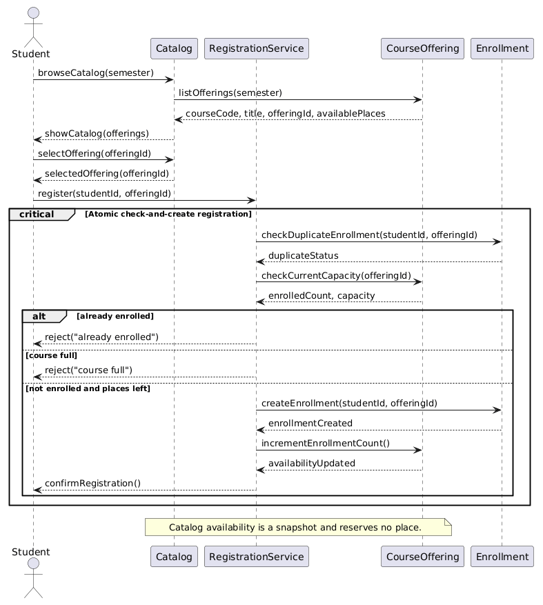
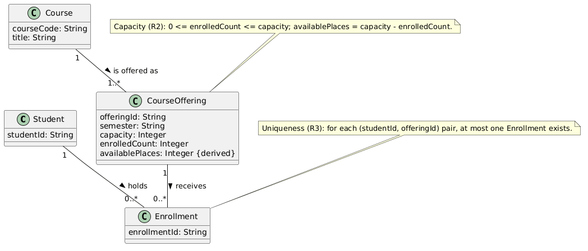
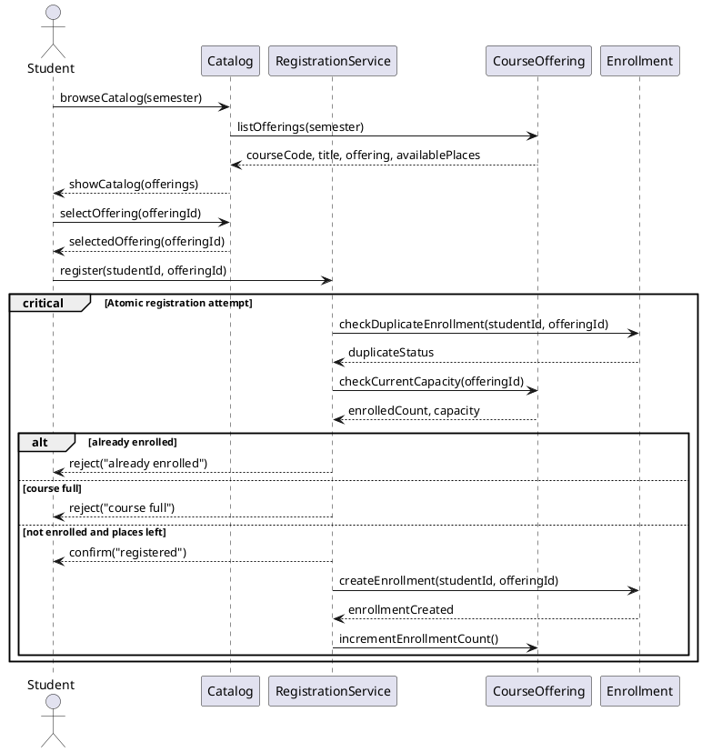
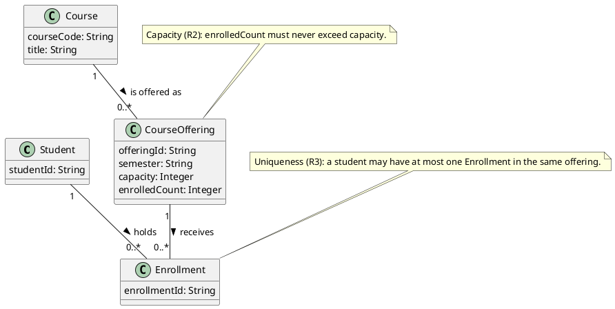
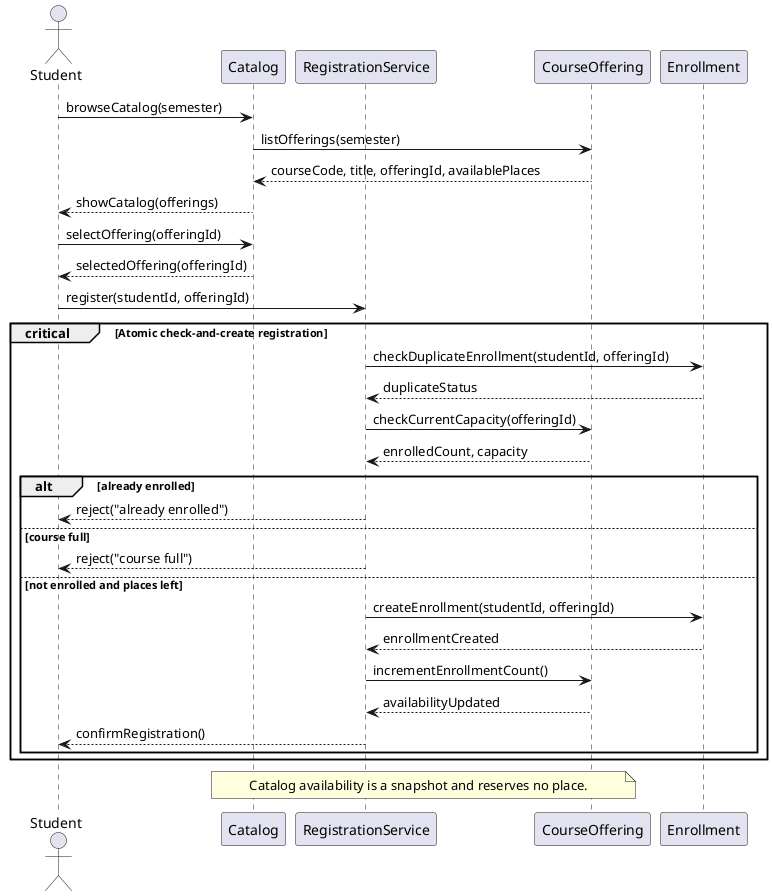
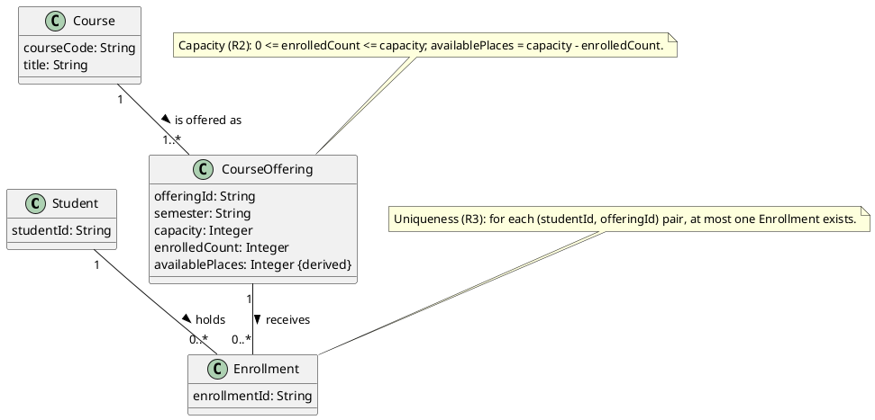
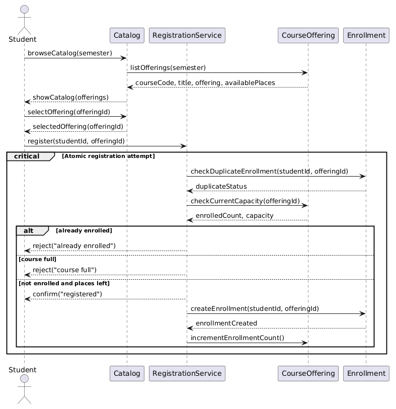
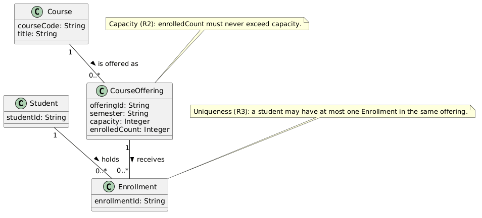

# SIS #02 — AI-Assisted UML Modeling: University Course Registration

<!--
  This is the only file you write your report in. README.md tells you what goes where.

  Rules the checker relies on:
  - Do not delete, rename or renumber the ## headings, the ### headings, or the **Label:** words.
  - Replace every "(write here)" and "(paste here)". None may be left when you submit.
  - Comments like this one are ignored by the checker and the word counter. Delete them or leave them.
-->

## 1. Scope and assumptions

<!-- Your FINAL scope statement and assumptions, after reviewing Prompt A's output. Say here
     what is out of scope (payments, prerequisites, timetable clashes, waiting lists,
     cancellation) — section 2 must not mention them. Section 10 keeps your first version. -->

**Scope:** This assignment models how a signed-in student browses one semester’s course offerings and requests enrollment in a selected offering. It covers catalog information, current capacity checks, duplicate rejection, successful enrollment, and clear rejection outcomes. Payments, prerequisites, timetable clashes, waiting lists, and cancellation are outside scope.

**Assumptions:**

1. The student is signed in before browsing the catalog or requesting registration.
2. The selected offering exists and has a positive whole-number capacity.

## 2. User stories and acceptance criteria

<!-- Your APPROVED requirements: Prompt A's draft after your review. Keep the IDs, the three
     story headings and the bullet shape. Every criterion names the rule(s) it maps to,
     e.g. (R2, R4). Two criteria per story. Nothing out of scope.
     Format of a criterion, on one bullet:
     - **AC-03** (R2, R4): Given ..., When ..., Then ... -->

### US-01 — Browse offerings

**US-01:** As a student, I want to browse offerings for one semester, so that I can compare course details and available places.

- **AC-01** (R1): Given the catalog contains offerings for a semester, When I browse that semester, Then each offering shows its course code, title, offering and available places.
- **AC-02** (R1): Given I am viewing a semester’s catalog, When I inspect an offering, Then the displayed available places describe that offering and do not reserve a place.

### US-02 — Register for an offering

**US-02:** As a student, I want to request registration in a selected offering, so that my enrollment is recorded and confirmed when the request succeeds.

- **AC-03** (R2, R4): Given I am not enrolled and a place is available, When I register for the selected offering, Then one Enrollment links me to that offering, availability decreases by one, and confirmation follows creation.
- **AC-04** (R2, R4): Given I am not enrolled and exactly one place remains, When I register for that offering, Then the final place is assigned by one atomic check-and-create operation and exactly one confirmation is returned.

### US-03 — Receive a clear rejection

**US-03:** As a student, I want a clear reason when registration is rejected, so that I know why my request did not change my enrollment.

- **AC-05** (R2, R5): Given the catalog showed a place but the offering is now full, When I request registration, Then I receive “course full”, no Enrollment is created, and the enrollment count remains unchanged.
- **AC-06** (R3, R5): Given I am already enrolled in the selected offering, When I request registration again, Then I receive “already enrolled”, no Enrollment is created, and the enrollment count remains unchanged.

## 3. Sequence diagram

<!-- The FINAL diagram, rendered. Change .png to .svg if that is what you exported. -->



**Participants:** `Student` is the registering student; `Catalog` displays offerings; `RegistrationService` coordinates the request; `CourseOffering` provides current capacity; `Enrollment` represents the registration record.

**Atomic operation:** The `critical Atomic check-and-create registration` region includes the final duplicate check, current capacity check, successful Enrollment creation and enrollment-count update. The catalog shows a snapshot and reserves no place.

**Where the Enrollment is created:** `RegistrationService -> Enrollment: createEnrollment(studentId, offeringId)` creates the `Enrollment` only in the success branch, after both checks.

**Technical lifelines:** `Catalog` and `RegistrationService` are interaction-level lifelines absent from the domain class diagram; they describe the conversation and coordination, while the class diagram shows persistent domain concepts.

## 4. Class diagram

<!-- The FINAL diagram, rendered. -->



<!-- One row per association in classes.puml, read in both directions. -->

| Association | Read left to right | Read right to left |
| --- | --- | --- |
| Student — Enrollment | One Student may hold zero or many Enrollments. | Each Enrollment links to exactly one Student. |
| CourseOffering — Enrollment | One CourseOffering may receive zero or many Enrollments. | Each Enrollment targets exactly one CourseOffering. |
| Course — CourseOffering | One Course is offered as one or more CourseOfferings. | Each CourseOffering describes one Course. |

**How an Enrollment links a student to an offering:** The `Enrollment` class is associated with one `Student` and one `CourseOffering`; its record therefore identifies the student’s registration in that specific scheduled section.

**Capacity constraint:** `enrolledCount` must stay between zero and `capacity`, and `availablePlaces` is derived as `capacity - enrolledCount`. Association multiplicities cannot express this numeric comparison between attributes.

**Uniqueness constraint:** For each `(studentId, offeringId)` pair, at most one `Enrollment` may exist. Multiplicities count links at each association end; they do not forbid duplicate pairs across separate Enrollment objects.

## 5. Traceability

<!-- Every rule, including the catalog fields and availability (R1). Column 1: the rule and
     the criteria that cover it, e.g. "R2 + AC-03, AC-04". Column 2: the message, guard,
     class or constraint that shows the rule in YOUR diagrams. Column 3: the T-ID that
     exercises it, or the extra check you did instead (R1 has no T case). -->

| Rule and criterion | Model evidence | Validation case |
| --- | --- | --- |
| R1 + AC-01, AC-02 | `listOfferings` returns course code, title, offeringId and derived availablePlaces for the requested semester. | T1 plus a catalog-field check |
| R2 + AC-03, AC-04, AC-05 | Final `checkCurrentCapacity`, the atomic critical region and the CourseOffering capacity constraint. | T2, T3 |
| R3 + AC-06 | `checkDuplicateEnrollment` and the separate uniqueness constraint on each student-offering pair. | T4 |
| R4 + AC-03, AC-04 | `createEnrollment`, then `incrementEnrollmentCount`, then `confirmRegistration` in the success branch. | T1, T2 |
| R5 + AC-05, AC-06 | The `course full` and `already enrolled` branches return the stated reason and contain no state-changing message. | T3, T4 |

## 6. Walkthroughs

<!-- Walk each case through YOUR final sequence diagram, message by message. Column 2: the
     actual steps and the state change (count before → after). Column 3 starts with Pass or
     Fail, then the location: the message, guard or note where you saw it. A Fail you
     report honestly is a finding, not a penalty. -->

| Case | Observed path and state change | Judgment and evidence |
| --- | --- | --- |
| T1. Available | Browse and select the offering; register; duplicate check is clear and current count is 0 of 2; create one Enrollment, increment the count to 1, then confirm. State: 0 → 1. | Pass — `not enrolled and places left`; `createEnrollment`, `incrementEnrollmentCount`, then `confirmRegistration`. |
| T2. Last place | Browse and select; register; duplicate check is clear and current count is 1 of 2; create one Enrollment, increment the count to 2, then confirm. State: 1 → 2; places left: 0. | Pass — atomic critical region contains `checkCurrentCapacity`, creation, count increment and confirmation after success. |
| T3. Full | Catalog showed a place, but registration rechecks current count 2 against capacity 2; `course full` returns a rejection. No create or increment message runs. State: 2 → 2. | Pass — `else course full` follows the final `checkCurrentCapacity`; rejection branch has no state-changing message. |
| T4. Duplicate | With count 1 of 2, the student registers again; duplicate check finds an existing pair, current capacity is rechecked, and `already enrolled` returns a rejection. No create or increment runs. State: 1 → 1. | Pass — `alt already enrolled` precedes the success branch; no state-changing message appears on the rejection path. |

## 7. Review decisions

<!-- At least three substantive decisions about Prompt C's critique or your own inspection.
     Decision: accepted / rejected / modified — and what you did. Reason: why, in a full
     sentence. Rule: R1–R5. Do not invent an error to fill the table; a justified rejection
     of advice counts. -->

| AI suggestion or model element | Decision | Reason | Rule |
| --- | --- | --- | --- |
| Original success path sent `confirm` before `createEnrollment` and the count update. | Accepted: moved confirmation after both state changes. | A confirmation before record creation can report success for an enrollment that was never stored; creation and count update now precede confirmation in the success branch. | R4 |
| Original critical region did not clearly complete the offering count update before returning. | Accepted: kept both final checks, Enrollment creation and count update in one critical region. | For T2, two requests must not both consume the last place; the final availability check and state change belong in the same atomic operation. | R2, R4 |
| Original class diagram had no displayed `availablePlaces` value. | Accepted: added derived `availablePlaces = capacity - enrolledCount`. | R1 asks the catalog to show available places, and deriving it from capacity and current enrollment count makes its source explicit without adding a class. | R1, R2 |
| Original Course-to-CourseOffering end used `0..*`. | Modified after checking the assignment’s required association example to `Course "1" -- "1..*" CourseOffering`. | The handout gives one or more offerings at the CourseOffering end; matching that exact expected relationship avoids leaving the required multiplicity weaker. | R1 |
| Critique proposed literal square-bracket guards. | Rejected the bracket characters; retained `alt already enrolled`, `else course full`, and `else not enrolled and places left`. | The assignment’s source-format instructions require unbracketed labels because PlantUML renders the alternative guard itself. | R2, R3, R5 |
| Section 9 requires the student’s personal reflection. | Left pending for the student; W2 is declared in `submission.yml`. | The reflection must describe the student’s own experience and decisions, so I cannot truthfully invent it without their input. | W2 / authorship requirement |

## 8. Modeling explanation

The sequence diagram follows the student from browsing a semester’s catalog to requesting one specific CourseOffering. The catalog response includes the course code, title, offering identifier and derived available places. That view is only a snapshot. It reserves nothing, so the registration request repeats the duplicate and current-capacity checks after the student submits it. The `critical` region keeps those checks, Enrollment creation and the offering count update in one modeled operation. The three `alt` outcomes separate duplicate rejection, full-course rejection and success. The success response comes after the record and count change; rejection branches return a reason and contain no state-changing message.

The class diagram describes the persistent domain structure behind that interaction. A Course describes one or more scheduled CourseOfferings, while each CourseOffering belongs to one Course. An Enrollment links exactly one Student to exactly one CourseOffering. Its multiplicity allows many registrations per student or offering, while a separate uniqueness constraint prevents the same student-offering pair from appearing twice. A second note constrains enrollment count by capacity; `availablePlaces` is derived from those values. The notes make rules visible that ordinary relationship counts cannot express.

The two diagrams answer different questions and cross-check each other. The sequence diagram shows when the domain objects are read or changed, and the class diagram shows which relationships and limits those messages must preserve. An activity diagram could also explain the workflow by showing the decision points for duplicate status and current capacity, followed by either a rejection or successful registration. It would make the branching path easy to scan, while the sequence diagram keeps the order of messages and the atomic check-and-create step explicit.

## 9. Reflection

<!-- 150–200 words. Written by you, not by the assistant: where AI helped, one decision you
     made yourself, one remaining limitation. Specific beats flattering. -->

Student-authored reflection pending: write 150–200 words in your own words after reviewing where AI helped, one decision you made yourself, and one remaining limitation.

## 10. Appendix A — Before AI

<!-- Written BEFORE you run Prompt A, committed and pushed in your first commit, and never
     edited afterwards. This is what you paste into Prompt A as "My initial assumptions". -->

**Scope:** This assignment models how a signed-in student browses one semester’s course offerings and requests enrollment in a selected offering. It covers catalog information, current capacity checks, duplicate rejection, successful enrollment, and clear rejection outcomes. Payments, prerequisites, timetable clashes, waiting lists, and cancellation are outside scope.

**Initial assumptions:**

1. The student is signed in before browsing the catalog or requesting registration.
2. The selected offering exists and has a positive whole-number capacity.

## 11. Appendix B — AI exchanges

<!-- Complete prompts and complete responses, as text — never screenshots. Paste each inside
     the ~~~~ block that follows its label: AI responses contain ``` PlantUML blocks, and
     ~~~~ keeps them from breaking this file. Prompts B and C: the prompt text first, then
     the material it refers to ("below", "these two") pasted under it, in the same block.
     You may add B5, B6 … after B4 if you ran more. -->

### B1 — Requirements (Prompt A)

- **Tool:** Codex
- **Model:** not displayed
- **Date:** 2026-10-18
- **Purpose:** draft 3 user stories and 6 acceptance criteria

<!-- Model: the exact model with its version, as the tool shows it (e.g. "GPT-5 Thinking",
     "Claude Sonnet 4.5"). If the tool does not show it, write: not displayed
     Date: YYYY-MM-DD -->

**Prompt:**

~~~~text
Act as a requirements analyst. Use only this course registration scenario and rules R1–R5: A student browses an electronic course catalog, chooses a course offering and requests registration. Each offering has a limited number of places. A Course describes a subject. A CourseOffering is one scheduled section in one semester. Registration always targets a specific offering. R1. Catalog: Show the course code, title, offering and available places for one semester. R2. Capacity: Recheck current availability when registering. Enrollment must never exceed the offering's capacity. R3. Duplicates: A student may have at most one enrollment in the same offering. Reject a repeat request. R4. Success: Create exactly one Enrollment linking the student and offering, update availability and return a confirmation. R5. Rejection: Explain "course full" or "already enrolled". Create no enrollment and leave the enrollment count unchanged. A catalog view does not reserve a place. Model the final checks and enrollment creation as one atomic operation so competing requests cannot take the same last place. My initial assumptions are 1. The student is signed in before browsing the catalog or requesting registration. 2. The selected offering exists and has a positive whole-number capacity.
Draft 3 user stories and 2 Given / When / Then acceptance criteria for each. Use IDs US-01 to US-03 and AC-01 to AC-06. Map each criterion to rule IDs.
Cover normal and rejection behavior. List uncertainty separately. Do not add excluded features or invent university policies.
~~~~

**Response:**

~~~~text
### US-01 — Browse offerings

**US-01:** As a student, I want to browse offerings for one semester, so that I can compare course details and available places.

- **AC-01** (R1): Given the catalog contains offerings for a semester, When I browse that semester, Then each offering shows its course code, title, offering and available places.
- **AC-02** (R1): Given I am viewing a semester’s catalog, When I inspect an offering, Then the displayed available places describe that offering and do not reserve a place.

### US-02 — Register for an offering

**US-02:** As a student, I want to request registration in a selected offering, so that my enrollment is recorded and confirmed when the request succeeds.

- **AC-03** (R2, R4): Given I am not enrolled and a place is available, When I register for the selected offering, Then one Enrollment links me to that offering, availability decreases by one, and confirmation follows creation.
- **AC-04** (R2, R4): Given I am not enrolled and exactly one place remains, When I register for that offering, Then the final place is assigned by one atomic check-and-create operation and exactly one confirmation is returned.

### US-03 — Receive a clear rejection

**US-03:** As a student, I want a clear reason when registration is rejected, so that I know why my request did not change my enrollment.

- **AC-05** (R2, R5): Given the catalog showed a place but the offering is now full, When I request registration, Then I receive “course full”, no Enrollment is created, and the enrollment count remains unchanged.
- **AC-06** (R3, R5): Given I am already enrolled in the selected offering, When I request registration again, Then I receive “already enrolled”, no Enrollment is created, and the enrollment count remains unchanged.

Uncertainty: R1 does not prescribe a visual format for the offering details. The criteria retain the required fields and make no additional university-policy assumptions.
~~~~

### B2 — UML drafts (Prompt B)

- **Tool:** Codex
- **Model:** not displayed
- **Date:** 2026-10-18
- **Purpose:** draft the sequence and class diagrams

**Prompt:**

~~~~text
Using my approved scenario, R1–R5, stories and criteria below, return separate PlantUML code blocks for a sequence diagram and a domain class diagram.
Sequence: include catalog browsing and guarded success, full-course and duplicate outcomes. Model final checks and creation as one atomic operation.
Class: show domain concepts, useful attributes and multiplicities. State the capacity and uniqueness constraints. Explain assumptions and any technical lifelines.

Approved scenario and rules:
A student browses an electronic course catalog, chooses a course offering and requests registration. Each offering has a limited number of places. A Course describes a subject. A CourseOffering is one scheduled section in one semester. Registration always targets a specific offering. The student is signed in, the selected offering exists, and its capacity is a positive whole number. R1 Catalog: Show the course code, title, offering and available places for one semester. R2 Capacity: Recheck current availability when registering. Enrollment must never exceed the offering's capacity. R3 Duplicates: A student may have at most one enrollment in the same offering. Reject a repeat request. R4 Success: Create exactly one Enrollment linking the student and offering, update availability and return a confirmation. R5 Rejection: Explain "course full" or "already enrolled". Create no enrollment and leave the enrollment count unchanged. A catalog view does not reserve a place. The final checks and enrollment creation are one atomic operation.

### US-01 — Browse offerings
**US-01:** As a student, I want to browse offerings for one semester, so that I can compare course details and available places.
- **AC-01** (R1): Given the catalog contains offerings for a semester, When I browse that semester, Then each offering shows its course code, title, offering and available places.
- **AC-02** (R1): Given I am viewing a semester’s catalog, When I inspect an offering, Then the displayed available places describe that offering and do not reserve a place.

### US-02 — Register for an offering
**US-02:** As a student, I want to request registration in a selected offering, so that my enrollment is recorded and confirmed when the request succeeds.
- **AC-03** (R2, R4): Given I am not enrolled and a place is available, When I register for the selected offering, Then one Enrollment links me to that offering, availability decreases by one, and confirmation follows creation.
- **AC-04** (R2, R4): Given I am not enrolled and exactly one place remains, When I register for that offering, Then the final place is assigned by one atomic check-and-create operation and exactly one confirmation is returned.

### US-03 — Receive a clear rejection
**US-03:** As a student, I want a clear reason when registration is rejected, so that I know why my request did not change my enrollment.
- **AC-05** (R2, R5): Given the catalog showed a place but the offering is now full, When I request registration, Then I receive “course full”, no Enrollment is created, and the enrollment count remains unchanged.
- **AC-06** (R3, R5): Given I am already enrolled in the selected offering, When I request registration again, Then I receive “already enrolled”, no Enrollment is created, and the enrollment count remains unchanged.
~~~~

**Response:**

~~~~text
The models below use Catalog and RegistrationService as technical lifelines; the domain classes remain Student, Course, CourseOffering and Enrollment. The atomic block represents the final duplicate and capacity checks and the enrollment attempt.





Assumptions: the signed-in student and selected offering are supplied to the registration request. The service and catalog are interaction-level lifelines, not additional domain classes. The offering count is the current enrolled count used to determine availability.
~~~~

### B3 — Model critique (Prompt C)

- **Tool:** Codex (separate chat: “SIS 02 Prompt C critique”)
- **Model:** not displayed
- **Date:** 2026-10-18
- **Purpose:** review both models against R1–R5 and T1–T4

**Prompt:**

~~~~text
Review these two UML models against R1–R5 and my acceptance criteria. Check message order, guards, state changes, multiplicities and naming.
Inspect the four validation cases: available places, exactly one place, full course after a stale catalog view, and duplicate registration.
For each issue, cite the affected rule and model element. Explain the impact and propose a focused correction. Separate genuine defects from optional design choices.

R1–R5:
R1 Catalog: Show the course code, title, offering and available places for one semester.
R2 Capacity: Recheck current availability when registering. Enrollment must never exceed the offering's capacity.
R3 Duplicates: A student may have at most one enrollment in the same offering. Reject a repeat request.
R4 Success: Create exactly one Enrollment linking the student and offering, update availability and return a confirmation.
R5 Rejection: Explain “course full” or “already enrolled”. Create no enrollment and leave the enrollment count unchanged. A catalog view does not reserve a place. Final checks and creation are one atomic operation.

Acceptance criteria:
- AC-01 (R1): Given the catalog contains offerings for a semester, When I browse that semester, Then each offering shows its course code, title, offering and available places.
- AC-02 (R1): Given I am viewing a semester’s catalog, When I inspect an offering, Then the displayed available places describe that offering and do not reserve a place.
- AC-03 (R2, R4): Given I am not enrolled and a place is available, When I register for the selected offering, Then one Enrollment links me to that offering, availability decreases by one, and confirmation follows creation.
- AC-04 (R2, R4): Given I am not enrolled and exactly one place remains, When I register for that offering, Then the final place is assigned by one atomic check-and-create operation and exactly one confirmation is returned.
- AC-05 (R2, R5): Given the catalog showed a place but the offering is now full, When I request registration, Then I receive “course full”, no Enrollment is created, and the enrollment count remains unchanged.
- AC-06 (R3, R5): Given I am already enrolled in the selected offering, When I request registration again, Then I receive “already enrolled”, no Enrollment is created, and the enrollment count remains unchanged.

Original sequence diagram:


Original class diagram:

~~~~

**Response:**

~~~~text
## Genuine defects

| Issue | Rule / element | Impact | Focused correction |
|---|---|---|---|
| Confirmation is sent before enrollment is created. In the sequence diagram’s `else not enrolled and places left` branch, `confirm("registered")` comes before `createEnrollment(...)` and `incrementEnrollmentCount()`. | R4; AC-03, AC-04 | The student can receive success even if creation or the availability update fails. | Create the Enrollment, update the offering’s enrollment state, then return confirmation. Make the checks, creation, and state update one atomic operation. |
| The atomicity guarantee is not clearly modeled. The `critical Atomic registration attempt` contains the checks, but also sends the response before creating the enrollment. The diagram does not show the offering’s state update as part of a clearly successful transaction. | R2, R4, R5; AC-04, AC-05 | Concurrent requests could both observe the last place as available and create enrollments, exceeding capacity. A catalog view does not reserve a place, so the final check must be authoritative. | Model one atomic check-and-create operation that rechecks current duplicate status and capacity, creates exactly one Enrollment and updates the offering only on success. Return the result after the operation completes. |
| The `alt` branches lack guard conditions. The labels `already enrolled`, `course full`, and `not enrolled and places left` are unbracketed branch descriptions. | R2, R3, R5; AC-03–AC-06 | The diagram does not formally show which conditions select each outcome, or that success requires both checks to pass. | Use explicit guards such as `[already enrolled]`, `[not enrolled and full]`, and `[not enrolled and places left]`. |
| The class diagram does not show how available places are obtained. `CourseOffering` has `capacity` and `enrolledCount`, but no `availablePlaces` attribute or operation. | R1; AC-01, AC-02 | The diagram does not make it clear that the catalog displays availability for each offering, or how that value relates to the offering. | Show `availablePlaces` as a derived value (`capacity - enrolledCount`) or add an operation that returns it. Keep the catalog display non-reserving. |

## Validation cases

- Available places: The intended success branch exists, but confirmation currently precedes creation. Reorder it and make sure the operation returns exactly one confirmation only after the Enrollment and offering state are updated.
- Exactly one place: Not safely guaranteed by the diagram as drawn. The `critical` label suggests serialization, but the success messages do not clearly put the final state change before the response. Model the last-place check and creation as one atomic operation.
- Full after a stale catalog view: The sequence rechecks current capacity, which is the right intent. Show an explicit `[not enrolled and full]` guard and return “course full” without creating an Enrollment or changing the count.
- Duplicate registration: The duplicate check and rejection are present. Show the duplicate guard explicitly and ensure the rejection path creates no Enrollment and leaves the count unchanged.

## Multiplicities and naming

The class diagram’s multiplicities are consistent with the stated rules: each Enrollment links to exactly one Student and one CourseOffering, while each Student and offering can have zero or more Enrollments. The Course-to-CourseOffering relationship also allows a course to have multiple offerings.

The names `checkDuplicateEnrollment`, `checkCurrentCapacity`, `createEnrollment`, and `incrementEnrollmentCount` are understandable. The main modeling concern is that `incrementEnrollmentCount()` is shown as a separate action after creation; include it in the atomic success operation so it cannot be skipped or applied inconsistently. Whether the duplicate check or capacity check happens first is a design choice, provided both are checked before creation and the stated rejection is returned when either rule fails.
~~~~

### B4 — Focused revision (Prompt D)

- **Tool:** Codex
- **Model:** not displayed
- **Date:** 2026-10-18
- **Purpose:** apply my accepted review decisions

**Prompt:**

~~~~text
Revise the UML sources using only my accepted review decisions: move confirmation after Enrollment creation and the offering count update; include the final duplicate and capacity checks, creation, and count update in one atomic critical region; show availablePlaces as a derived CourseOffering value; change Course-to-CourseOffering multiplicity to the assignment’s required 1 to 1..*; keep guard labels unbracketed as the assignment requires. Keep justified existing elements and explain each change.
Preserve the agreed scope and rule IDs. Return both updated PlantUML blocks and a concise change log. Flag any unresolved issue.
Approved requirements: US-01: As a student, I want to browse offerings for one semester, so that I can compare course details and available places. US-02: As a student, I want to request registration in a selected offering, so that my enrollment is recorded and confirmed when the request succeeds. US-03: As a student, I want a clear reason when registration is rejected, so that I know why my request did not change my enrollment. AC-01 (R1): Given the catalog contains offerings for a semester, When I browse that semester, Then each offering shows its course code, title, offering and available places. AC-02 (R1): Given I am viewing a semester’s catalog, When I inspect an offering, Then the displayed available places describe that offering and do not reserve a place. AC-03 (R2, R4): Given I am not enrolled and a place is available, When I register for the selected offering, Then one Enrollment links me to that offering, availability decreases by one, and confirmation follows creation. AC-04 (R2, R4): Given I am not enrolled and exactly one place remains, When I register for that offering, Then the final place is assigned by one atomic check-and-create operation and exactly one confirmation is returned. AC-05 (R2, R5): Given the catalog showed a place but the offering is now full, When I request registration, Then I receive “course full”, no Enrollment is created, and the enrollment count remains unchanged. AC-06 (R3, R5): Given I am already enrolled in the selected offering, When I request registration again, Then I receive “already enrolled”, no Enrollment is created, and the enrollment count remains unchanged.
Original sources:
Sequence:
@startuml
actor Student
participant Catalog
participant RegistrationService
participant CourseOffering
participant Enrollment

Student -> Catalog: browseCatalog(semester)
Catalog -> CourseOffering: listOfferings(semester)
CourseOffering --> Catalog: courseCode, title, offering, availablePlaces
Catalog --> Student: showCatalog(offerings)
Student -> Catalog: selectOffering(offeringId)
Catalog --> Student: selectedOffering(offeringId)
Student -> RegistrationService: register(studentId, offeringId)

critical Atomic registration attempt
  RegistrationService -> Enrollment: checkDuplicateEnrollment(studentId, offeringId)
  Enrollment --> RegistrationService: duplicateStatus
  RegistrationService -> CourseOffering: checkCurrentCapacity(offeringId)
  CourseOffering --> RegistrationService: enrolledCount, capacity
  alt already enrolled
    RegistrationService --> Student: reject("already enrolled")
  else course full
    RegistrationService --> Student: reject("course full")
  else not enrolled and places left
    RegistrationService --> Student: confirm("registered")
    RegistrationService -> Enrollment: createEnrollment(studentId, offeringId)
    Enrollment --> RegistrationService: enrollmentCreated
    RegistrationService -> CourseOffering: incrementEnrollmentCount()
  end
end
@enduml

Classes:
@startuml
class Student {
  studentId: String
}

class Course {
  courseCode: String
  title: String
}

class CourseOffering {
  offeringId: String
  semester: String
  capacity: Integer
  enrolledCount: Integer
}

class Enrollment {
  enrollmentId: String
}

Student "1" -- "0..*" Enrollment : holds >
CourseOffering "1" -- "0..*" Enrollment : receives >
Course "1" -- "0..*" CourseOffering : is offered as >

note "Capacity (R2): enrolledCount must never exceed capacity." as CapacityRule
CapacityRule .. CourseOffering
note "Uniqueness (R3): a student may have at most one Enrollment in the same offering." as UniqueRule
UniqueRule .. Enrollment
@enduml

My review decisions and evidence: I accepted the critique that confirmation must follow Enrollment creation and the CourseOffering count update (R4), and that both final checks and all successful state changes must stay within the atomic region (R2, R4). I accepted adding derived availablePlaces because R1 requires displaying it. I changed Course-to-CourseOffering multiplicity to 1 and 1..* because that is the assignment’s specified example. I rejected literal square brackets in guard source because the assignment specifies unbracketed alt/else labels.
~~~~

**Response:**

~~~~text
The revised diagrams apply the accepted corrections. No additional classes or out-of-scope behavior were added.





Change log: moved confirmation after creation and the count update; kept both final checks and success state changes inside one critical region; displayed availablePlaces as a derived value; used the specified Course-to-CourseOffering multiplicity; kept the three alternative labels unbracketed. The catalog remains non-reserving. No unresolved modeling issue remains within the stated scope; implementation details are outside scope.
~~~~

## 12. Appendix C — Original diagrams

<!-- The AI's first output from Prompt B, rendered unedited from models/original/. -->





## 13. Appendix D — References and source checks

### References

<!-- Full references, one per line, each starting with "- ". Only sources you actually opened.
     Every URL used in the source checks must also appear here. Example:
     - Sommerville, I. (2016). Software Engineering, 10th ed., Global Edition. Pearson. Ch. 5. -->

- PlantUML. “Sequence Diagram syntax and features.” https://plantuml.com/sequence-diagram. Accessed 2026-10-18.
- PlantUML. “Class Diagram syntax and features.” https://plantuml.com/class-diagram. Accessed 2026-10-18.
- Object Management Group. UML 2.0 Infrastructure Specification, ISO/IEC 19505-1:2012, §9.6.1, pp. 42–44. https://www.omg.org/spec/UML/ISO/19505-1/PDF. Accessed 2026-10-18.

### Source checks

<!-- At least two modeling decisions you verified. Source and locator: title + slide, page,
     section, chapter or figure — or title + URL + access date (YYYY-MM-DD). Slide numbers
     refer to the decks posted in our Teams. -->

| Modeling decision | Source and locator | What the source says | How it supports or changed your model |
| --- | --- | --- | --- |
| Use an alternative frame and critical region for guarded, atomic registration. | PlantUML, “Sequence Diagram syntax and features,” “Grouping message,” https://plantuml.com/sequence-diagram (accessed 2026-10-18). | PlantUML supports `alt`/`else`, `critical`, `group`, and nested message groups. | I used an `alt` frame for the three outcomes and a `critical` region to communicate the intended indivisible check-and-create flow. The notation states the model intent; it does not implement transaction control. |
| State both association multiplicities and separate model constraints. | PlantUML, “Class Diagram syntax and features,” “Label on relations,” https://plantuml.com/class-diagram (accessed 2026-10-18); OMG, UML 2.0 Infrastructure, §9.6.1, pp. 42–44, https://www.omg.org/spec/UML/ISO/19505-1/PDF (accessed 2026-10-18). | PlantUML places cardinalities in quoted labels at relation ends. OMG defines a constraint as a restriction that adds semantics beyond other language constructs and permits note notation. | I displayed both association-end cardinalities and attached capacity and uniqueness notes, because those cross-attribute and pairwise rules are not expressed by the shown multiplicities. |
