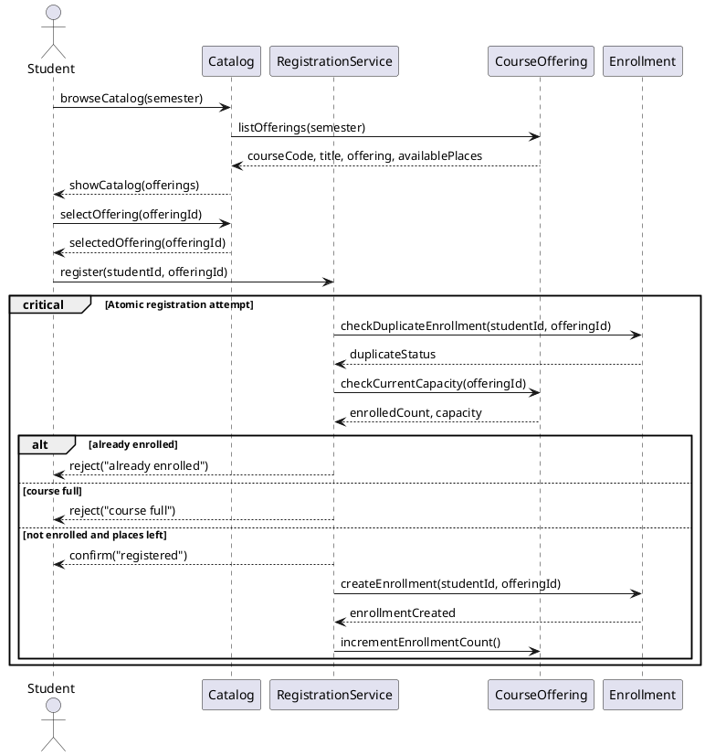
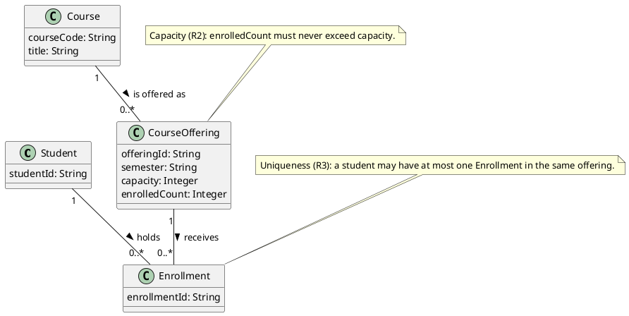

# SIS #02 — AI-Assisted UML Modeling: University Course Registration

<!--
  This is the only file you write your report in. README.md tells you what goes where.

  Rules the checker relies on:
  - Do not delete, rename or renumber the ## headings, the ### headings, or the **Label:** words.
  - Replace every "(write here)" and "(paste here)". None may be left when you submit.
  - Comments like this one are ignored by the checker and the word counter. Delete them or leave them.
-->

## 1. Scope and assumptions

<!-- Your FINAL scope statement and assumptions, after reviewing Prompt A's output. Say here
     what is out of scope (payments, prerequisites, timetable clashes, waiting lists,
     cancellation) — section 2 must not mention them. Section 10 keeps your first version. -->

**Scope:** This assignment models how a signed-in student browses one semester’s course offerings and requests enrollment in a selected offering. It covers catalog information, current capacity checks, duplicate rejection, successful enrollment, and clear rejection outcomes. Payments, prerequisites, timetable clashes, waiting lists, and cancellation are outside scope.

**Assumptions:**

1. The student is signed in before browsing the catalog or requesting registration.
2. The selected offering exists and has a positive whole-number capacity.

## 2. User stories and acceptance criteria

<!-- Your APPROVED requirements: Prompt A's draft after your review. Keep the IDs, the three
     story headings and the bullet shape. Every criterion names the rule(s) it maps to,
     e.g. (R2, R4). Two criteria per story. Nothing out of scope.
     Format of a criterion, on one bullet:
     - **AC-03** (R2, R4): Given ..., When ..., Then ... -->

### US-01 — Browse offerings

**US-01:** As a student, I want to browse offerings for one semester, so that I can compare course details and available places.

- **AC-01** (R1): Given the catalog contains offerings for a semester, When I browse that semester, Then each offering shows its course code, title, offering and available places.
- **AC-02** (R1): Given I am viewing a semester’s catalog, When I inspect an offering, Then the displayed available places describe that offering and do not reserve a place.

### US-02 — Register for an offering

**US-02:** As a student, I want to request registration in a selected offering, so that my enrollment is recorded and confirmed when the request succeeds.

- **AC-03** (R2, R4): Given I am not enrolled and a place is available, When I register for the selected offering, Then one Enrollment links me to that offering, availability decreases by one, and confirmation follows creation.
- **AC-04** (R2, R4): Given I am not enrolled and exactly one place remains, When I register for that offering, Then the final place is assigned by one atomic check-and-create operation and exactly one confirmation is returned.

### US-03 — Receive a clear rejection

**US-03:** As a student, I want a clear reason when registration is rejected, so that I know why my request did not change my enrollment.

- **AC-05** (R2, R5): Given the catalog showed a place but the offering is now full, When I request registration, Then I receive “course full”, no Enrollment is created, and the enrollment count remains unchanged.
- **AC-06** (R3, R5): Given I am already enrolled in the selected offering, When I request registration again, Then I receive “already enrolled”, no Enrollment is created, and the enrollment count remains unchanged.

## 3. Sequence diagram

<!-- The FINAL diagram, rendered. Change .png to .svg if that is what you exported. -->


**Participants:** (write here — each lifeline and what it stands for)

**Atomic operation:** (write here — which messages form the one atomic step: the final duplicate check, the capacity check and the creation of the Enrollment, and why a catalog view reserves nothing)

**Where the Enrollment is created:** (write here — which message, which lifeline, and which class in section 4 it produces)

**Technical lifelines:** (write here — every lifeline that is NOT a class in the class diagram, by name, and why the difference in abstraction is fine. "None" if there are none.)

## 4. Class diagram

<!-- The FINAL diagram, rendered. -->


<!-- One row per association in classes.puml, read in both directions. -->

| Association | Read left to right | Read right to left |
| --- | --- | --- |
| (write here) | (write here) | (write here) |
| (write here) | (write here) | (write here) |
| (write here) | (write here) | (write here) |

**How an Enrollment links a student to an offering:** (write here)

**Capacity constraint:** (write here — and why multiplicity alone cannot express it)

**Uniqueness constraint:** (write here — and why multiplicity alone cannot express it)

## 5. Traceability

<!-- Every rule, including the catalog fields and availability (R1). Column 1: the rule and
     the criteria that cover it, e.g. "R2 + AC-03, AC-04". Column 2: the message, guard,
     class or constraint that shows the rule in YOUR diagrams. Column 3: the T-ID that
     exercises it, or the extra check you did instead (R1 has no T case). -->

| Rule and criterion | Model evidence | Validation case |
| --- | --- | --- |
| R1 + (write here) | (write here) | (write here) |
| R2 + (write here) | (write here) | (write here) |
| R3 + (write here) | (write here) | (write here) |
| R4 + (write here) | (write here) | (write here) |
| R5 + (write here) | (write here) | (write here) |

## 6. Walkthroughs

<!-- Walk each case through YOUR final sequence diagram, message by message. Column 2: the
     actual steps and the state change (count before → after). Column 3 starts with Pass or
     Fail, then the location: the message, guard or note where you saw it. A Fail you
     report honestly is a finding, not a penalty. -->

| Case | Observed path and state change | Judgment and evidence |
| --- | --- | --- |
| T1. Available | (write here) | (write here) |
| T2. Last place | (write here) | (write here) |
| T3. Full | (write here) | (write here) |
| T4. Duplicate | (write here) | (write here) |

## 7. Review decisions

<!-- At least three substantive decisions about Prompt C's critique or your own inspection.
     Decision: accepted / rejected / modified — and what you did. Reason: why, in a full
     sentence. Rule: R1–R5. Do not invent an error to fill the table; a justified rejection
     of advice counts. -->

| AI suggestion or model element | Decision | Reason | Rule |
| --- | --- | --- | --- |
| (write here) | (write here) | (write here) | (write here) |
| (write here) | (write here) | (write here) | (write here) |
| (write here) | (write here) | (write here) | (write here) |

## 8. Modeling explanation

<!-- 200–300 words. Your main design choices; how the class diagram and the sequence diagram
     complement each other; why an activity diagram could also help explain the workflow. -->

(write here)

## 9. Reflection

<!-- 150–200 words. Written by you, not by the assistant: where AI helped, one decision you
     made yourself, one remaining limitation. Specific beats flattering. -->

(write here)

## 10. Appendix A — Before AI

<!-- Written BEFORE you run Prompt A, committed and pushed in your first commit, and never
     edited afterwards. This is what you paste into Prompt A as "My initial assumptions". -->

**Scope:** This assignment models how a signed-in student browses one semester’s course offerings and requests enrollment in a selected offering. It covers catalog information, current capacity checks, duplicate rejection, successful enrollment, and clear rejection outcomes. Payments, prerequisites, timetable clashes, waiting lists, and cancellation are outside scope.

**Initial assumptions:**

1. The student is signed in before browsing the catalog or requesting registration.
2. The selected offering exists and has a positive whole-number capacity.

## 11. Appendix B — AI exchanges

<!-- Complete prompts and complete responses, as text — never screenshots. Paste each inside
     the ~~~~ block that follows its label: AI responses contain ``` PlantUML blocks, and
     ~~~~ keeps them from breaking this file. Prompts B and C: the prompt text first, then
     the material it refers to ("below", "these two") pasted under it, in the same block.
     You may add B5, B6 … after B4 if you ran more. -->

### B1 — Requirements (Prompt A)

- **Tool:** Codex
- **Model:** not displayed
- **Date:** 2026-10-18
- **Purpose:** draft 3 user stories and 6 acceptance criteria

<!-- Model: the exact model with its version, as the tool shows it (e.g. "GPT-5 Thinking",
     "Claude Sonnet 4.5"). If the tool does not show it, write: not displayed
     Date: YYYY-MM-DD -->

**Prompt:**

~~~~text
Act as a requirements analyst. Use only this course registration scenario and rules R1–R5: A student browses an electronic course catalog, chooses a course offering and requests registration. Each offering has a limited number of places. A Course describes a subject. A CourseOffering is one scheduled section in one semester. Registration always targets a specific offering. R1. Catalog: Show the course code, title, offering and available places for one semester. R2. Capacity: Recheck current availability when registering. Enrollment must never exceed the offering's capacity. R3. Duplicates: A student may have at most one enrollment in the same offering. Reject a repeat request. R4. Success: Create exactly one Enrollment linking the student and offering, update availability and return a confirmation. R5. Rejection: Explain "course full" or "already enrolled". Create no enrollment and leave the enrollment count unchanged. A catalog view does not reserve a place. Model the final checks and enrollment creation as one atomic operation so competing requests cannot take the same last place. My initial assumptions are 1. The student is signed in before browsing the catalog or requesting registration. 2. The selected offering exists and has a positive whole-number capacity.
Draft 3 user stories and 2 Given / When / Then acceptance criteria for each. Use IDs US-01 to US-03 and AC-01 to AC-06. Map each criterion to rule IDs.
Cover normal and rejection behavior. List uncertainty separately. Do not add excluded features or invent university policies.
~~~~

**Response:**

~~~~text
### US-01 — Browse offerings

**US-01:** As a student, I want to browse offerings for one semester, so that I can compare course details and available places.

- **AC-01** (R1): Given the catalog contains offerings for a semester, When I browse that semester, Then each offering shows its course code, title, offering and available places.
- **AC-02** (R1): Given I am viewing a semester’s catalog, When I inspect an offering, Then the displayed available places describe that offering and do not reserve a place.

### US-02 — Register for an offering

**US-02:** As a student, I want to request registration in a selected offering, so that my enrollment is recorded and confirmed when the request succeeds.

- **AC-03** (R2, R4): Given I am not enrolled and a place is available, When I register for the selected offering, Then one Enrollment links me to that offering, availability decreases by one, and confirmation follows creation.
- **AC-04** (R2, R4): Given I am not enrolled and exactly one place remains, When I register for that offering, Then the final place is assigned by one atomic check-and-create operation and exactly one confirmation is returned.

### US-03 — Receive a clear rejection

**US-03:** As a student, I want a clear reason when registration is rejected, so that I know why my request did not change my enrollment.

- **AC-05** (R2, R5): Given the catalog showed a place but the offering is now full, When I request registration, Then I receive “course full”, no Enrollment is created, and the enrollment count remains unchanged.
- **AC-06** (R3, R5): Given I am already enrolled in the selected offering, When I request registration again, Then I receive “already enrolled”, no Enrollment is created, and the enrollment count remains unchanged.

Uncertainty: R1 does not prescribe a visual format for the offering details. The criteria retain the required fields and make no additional university-policy assumptions.
~~~~

**Response:**

~~~~text
(paste here)
~~~~

### B2 — UML drafts (Prompt B)

- **Tool:** Codex
- **Model:** not displayed
- **Date:** 2026-10-18
- **Purpose:** draft the sequence and class diagrams

**Prompt:**

~~~~text
Using my approved scenario, R1–R5, stories and criteria below, return separate PlantUML code blocks for a sequence diagram and a domain class diagram.
Sequence: include catalog browsing and guarded success, full-course and duplicate outcomes. Model final checks and creation as one atomic operation.
Class: show domain concepts, useful attributes and multiplicities. State the capacity and uniqueness constraints. Explain assumptions and any technical lifelines.

Approved scenario and rules:
A student browses an electronic course catalog, chooses a course offering and requests registration. Each offering has a limited number of places. A Course describes a subject. A CourseOffering is one scheduled section in one semester. Registration always targets a specific offering. The student is signed in, the selected offering exists, and its capacity is a positive whole number. R1 Catalog: Show the course code, title, offering and available places for one semester. R2 Capacity: Recheck current availability when registering. Enrollment must never exceed the offering's capacity. R3 Duplicates: A student may have at most one enrollment in the same offering. Reject a repeat request. R4 Success: Create exactly one Enrollment linking the student and offering, update availability and return a confirmation. R5 Rejection: Explain "course full" or "already enrolled". Create no enrollment and leave the enrollment count unchanged. A catalog view does not reserve a place. The final checks and enrollment creation are one atomic operation.

### US-01 — Browse offerings
**US-01:** As a student, I want to browse offerings for one semester, so that I can compare course details and available places.
- **AC-01** (R1): Given the catalog contains offerings for a semester, When I browse that semester, Then each offering shows its course code, title, offering and available places.
- **AC-02** (R1): Given I am viewing a semester’s catalog, When I inspect an offering, Then the displayed available places describe that offering and do not reserve a place.

### US-02 — Register for an offering
**US-02:** As a student, I want to request registration in a selected offering, so that my enrollment is recorded and confirmed when the request succeeds.
- **AC-03** (R2, R4): Given I am not enrolled and a place is available, When I register for the selected offering, Then one Enrollment links me to that offering, availability decreases by one, and confirmation follows creation.
- **AC-04** (R2, R4): Given I am not enrolled and exactly one place remains, When I register for that offering, Then the final place is assigned by one atomic check-and-create operation and exactly one confirmation is returned.

### US-03 — Receive a clear rejection
**US-03:** As a student, I want a clear reason when registration is rejected, so that I know why my request did not change my enrollment.
- **AC-05** (R2, R5): Given the catalog showed a place but the offering is now full, When I request registration, Then I receive “course full”, no Enrollment is created, and the enrollment count remains unchanged.
- **AC-06** (R3, R5): Given I am already enrolled in the selected offering, When I request registration again, Then I receive “already enrolled”, no Enrollment is created, and the enrollment count remains unchanged.
~~~~

**Response:**

~~~~text
The models below use Catalog and RegistrationService as technical lifelines; the domain classes remain Student, Course, CourseOffering and Enrollment. The atomic block represents the final duplicate and capacity checks and the enrollment attempt.





Assumptions: the signed-in student and selected offering are supplied to the registration request. The service and catalog are interaction-level lifelines, not additional domain classes. The offering count is the current enrolled count used to determine availability.
~~~~

### B3 — Model critique (Prompt C)

- **Tool:** (write here)
- **Model:** (write here)
- **Date:** (write here)
- **Purpose:** review both models against R1–R5 and T1–T4

**Prompt:**

~~~~text
(paste here)
~~~~

**Response:**

~~~~text
(paste here)
~~~~

### B4 — Focused revision (Prompt D)

- **Tool:** (write here)
- **Model:** (write here)
- **Date:** (write here)
- **Purpose:** apply my accepted review decisions

**Prompt:**

~~~~text
(paste here)
~~~~

**Response:**

~~~~text
(paste here)
~~~~

## 12. Appendix C — Original diagrams

<!-- The AI's first output from Prompt B, rendered unedited from models/original/. -->


## 13. Appendix D — References and source checks

### References

<!-- Full references, one per line, each starting with "- ". Only sources you actually opened.
     Every URL used in the source checks must also appear here. Example:
     - Sommerville, I. (2016). Software Engineering, 10th ed., Global Edition. Pearson. Ch. 5. -->

- (write here)

### Source checks

<!-- At least two modeling decisions you verified. Source and locator: title + slide, page,
     section, chapter or figure — or title + URL + access date (YYYY-MM-DD). Slide numbers
     refer to the decks posted in our Teams. -->

| Modeling decision | Source and locator | What the source says | How it supports or changed your model |
| --- | --- | --- | --- |
| (write here) | (write here) | (write here) | (write here) |
| (write here) | (write here) | (write here) | (write here) |
